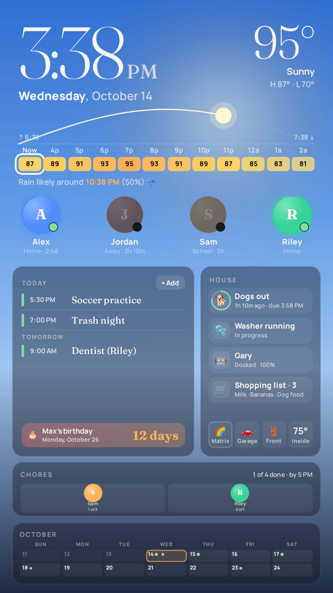
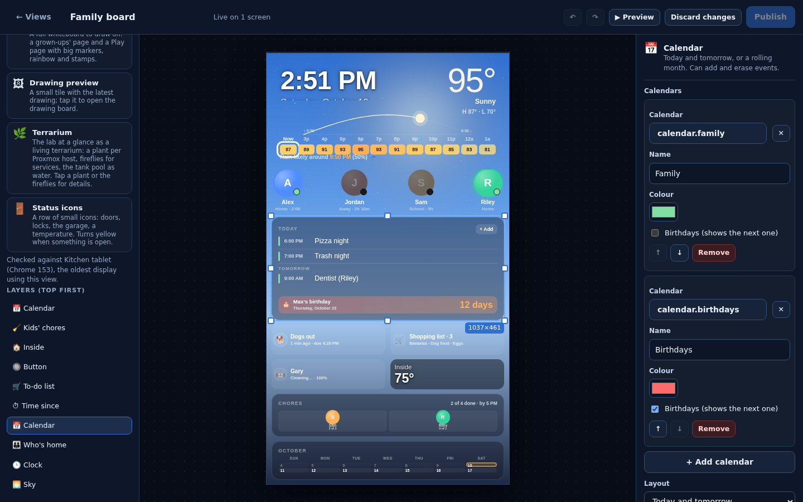
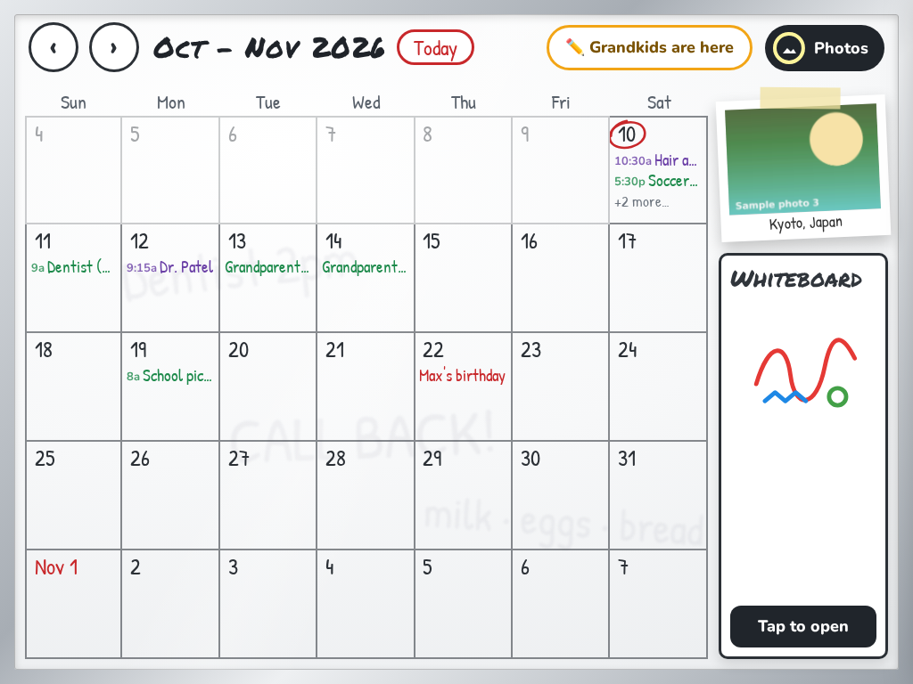
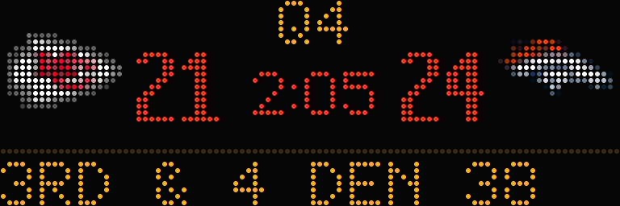

# CoreView Studio

Turn any screen with a web browser into a Home Assistant display: an old
iPad, an Android tablet or photo frame, a Surface, a laptop, a Raspberry Pi on
a TV. Design what each one shows in a drag-and-drop editor. It drives LED signs
around the house, too.

**Nothing to install on the screens.** No app, no APK, no rooting, no
particular brand of tablet: a screen opens one web page, shows a pairing code,
and from then on shows whatever view you give it, live. If it has a browser
that's not ancient, there's a good chance it works. The display page is plain
ES5 and runs on Chrome 44-era Android frames.

CoreView Studio is a self-hosted web app. You open **Studio** in your browser
to design "views" on a canvas and choose which screen shows which view.
It also drives LED matrix signs: a 96x32 ESPHome panel (clock, alerts, sports
scoreboards with team logos) and a 16x16 WLED panel (little home "scenes" like
"the back door is open" or "the dryer is done").

This is version 2.6. It replaces CoreView V1 (see [Coming from V1](#coming-from-v1)).



| The editor | Grandma's whiteboard |
| --- | --- |
|  |  |

| The 96x32 Matrix scoreboard | The 16x16 WLED panel scenes |
| --- | --- |
|  |  |

---

## Development transparency

CoreView was built with AI assistance. The architecture, code, documentation
and tests came out of a collaboration between a human operator and AI coding
assistants, used as development tools rather than an autonomous system. The
maintainer directed the design, chose what to build, tested it on real devices
in a real house, and reviewed the security boundaries. AI tools wrote most of
the code and helped explore options.

It's shared as an honest example of what that workflow can produce: a
hobby project that a family uses every day.

---

## What it can do

**Screens and views**
- Pair any browser with a 4-character code shown on the screen: an iPad, an
  Android tablet or frame (its browser, or a kiosk app such as Fully Kiosk
  Browser), a Windows tablet, a PC, a Raspberry Pi. See
  [Which screens work](#which-screens-work).
- Design views on a canvas that uses the same renderer as the screens, so what
  you see in the editor is what the screen shows. Save drafts, preview, publish.
- Views can link to each other: a tap switches to another view, and a screen
  goes back to its idle view after a while without a touch (e.g. a photo frame
  that becomes a calendar when someone touches it).
- Works on very old browsers: the display page is plain ES5 and is tested down
  to Chrome 44 (Android 6 frames). A widget that needs a newer browser than a
  screen has is greyed out for that screen.
- Night dimming, per-screen PINs, and live thumbnails of every screen in Studio.

**Widgets**

| Widget | What it shows |
| --- | --- |
| Photo slideshow | an Immich album, with captions (place, year) |
| Clock, Text, Weather, Sky | time, a message, current weather, a sky that follows the real sun and moon with a 12-hour temperature ribbon |
| Home Assistant tile, Status icons, Status tile | any entity; a row of door/lock/garage icons; "quiet until busy" tiles (washer and dryer) |
| Calendar | today and tomorrow, or a rolling month; add and erase events from the screen |
| Who's home | people with their pictures, home or away |
| To-do list, Kids' chores | Home Assistant to-do lists; tap to tick things off |
| Time since | "the dogs went out 1h ago", with a reminder ring and a button |
| Button | run a script, start the vacuum, toggle something, switch views, or turn on Grandkids mode |
| Who came by | recent Frigate events (snapshots and clips) |
| Card | a see-through panel to group widgets |
| Whiteboard calendar, Sticky note, Drawing board, Drawing preview | a big-print marker calendar, today's note, and a drawing board with a Play page for the grandkids (made for a grandparent's touch frame) |
| Terrarium | a homelab "at a glance" (Proxmox + Prometheus; optional, see below) |
| Now showing | a movie-theatre poster for what was just added to Jellyfin, switching to what's playing (optional, needs a Jellyfin API key) |

**Camera pop-up**: when Frigate sees a person on cameras you pick (optionally
only in certain zones and hours), chosen screens pop up that camera's live view
for a few seconds.

**Timer pop-up**: while a Home Assistant timer (`timer.*` helper) runs, chosen
screens show a countdown card over whatever view they show, with pause and a
flashing "Done!" (per screen: **Timer pop-up** on the Screens page). The Matrix
can show the same countdown instead of its clock.

**Settings**: every connection (Home Assistant, MQTT, Immich, Frigate,
Jellyfin, Prometheus) with its status and a **Test** button. Set them up right
in the browser (tested before saving, keys never shown again), or keep them in
`.env` and `secrets/`. Change the admin password, and download or restore a
backup of your screens and views.

**The LED Matrix (96x32, MQTT)**: a clock with a Home Assistant line under it
("Out: 72°"), colour themes by time of day, alerts and notifications from Home
Assistant, a scrolling marquee, Lights and Music modes, and a sports scoreboard
when a team you follow is playing (team logos, away team left, home team
right). The firmware is in [`firmware/beacon/`](firmware/beacon/README.md); the
protocol is in [`docs/matrix-mqtt-protocol.md`](docs/matrix-mqtt-protocol.md).

**A 16x16 WLED panel**: Studio sends little animated icons to a 16x16 WLED
matrix only when something happens (someone came home, a door is open, a
person on a camera, the dogs need out, the washer or dryer is done, an alert)
and WLED runs its own effects the rest of the time. Quiet hours keep it dark at
night except for alerts and cameras. No firmware change needed.

---

## Quick start

### You need

- A Linux machine with **Docker** and Docker Compose.
- **Home Assistant** (most widgets read it). Optional: **Immich** for photos,
  **Frigate** for cameras, an **MQTT broker** (e.g. Home Assistant's Mosquitto
  add-on) for the LED Matrix, a **WLED** panel.
- Ideally a **reverse proxy with HTTPS** (Nginx Proxy Manager, Caddy, Traefik)
  in front of Studio. Sign-in cookies are HTTPS-only by default; for a quick
  test on your own network set `COOKIE_SECURE=0`.

### 1. Get the code and folders

```bash
git clone https://github.com/2shepard2/CoreView.git coreview
cd coreview
mkdir -p data secrets
cp .env.example .env
```

### 2. Secrets

Each secret is a small file in `./secrets` containing only the value:

| File | What | Needed |
| --- | --- | --- |
| `setup_code` | any one-time code you make up; Studio asks for it when you create the admin account | for the first sign-in |
| `ha_token` | a Home Assistant long-lived access token ([how](docs/home-assistant.md#1-a-long-lived-access-token)) | for Home Assistant |
| `immich_api_key` | an Immich API key (Immich → Account settings → API keys) | for photos |
| `mqtt_password` | the MQTT user's password | for the LED Matrix |
| `agent_token` | a long random string | only to call Studio's API from scripts |

Create the files first, then hand both folders to the container's user
(10250), so only it (and root) can read them:

```bash
openssl rand -hex 16 > secrets/setup_code
echo 'YOUR_HA_TOKEN' > secrets/ha_token      # and any others you use
sudo chown -R 10250:10250 data secrets
sudo chmod 700 data secrets && sudo chmod 400 secrets/*
```

After this, read or change a secret with `sudo` (e.g.
`sudo cat secrets/setup_code`), then `docker compose restart`.

### 3. Settings

Edit `.env` (every setting is explained in [`.env.example`](.env.example)). At
least set `TZ`. Connections (Home Assistant, Immich, MQTT, ...) can go in
`.env` + `secrets/` **or** be set later on Studio's **Settings** page; leave a
URL blank to turn that feature off or to set it in the browser.

| Setting | Default | What |
| --- | --- | --- |
| `TZ` | `UTC` | your time zone (clocks, quiet hours, themes) |
| `BIND_ADDRESS`, `DISPLAY_PORT`, `ADMIN_PORT` | `0.0.0.0`, `3216`, `3217` | where the two ports listen on the host |
| `COOKIE_SECURE` | `1` | `0` allows sign-in over plain HTTP (testing only) |
| `HA_URL` | | Home Assistant, e.g. `http://homeassistant.local:8123` |
| `IMMICH_URL` | | Immich, e.g. `http://immich.local:2283` |
| `FRIGATE_URL` | | Frigate's HTTP API, e.g. `http://frigate.local:5000` |
| `MQTT_URL` | | the broker for the LED Matrix, e.g. `mqtt://homeassistant.local:1883` (plain MQTT; `mqtts://` isn't supported) |
| `MQTT_USERNAME` | | the broker user (password in `secrets/mqtt_password`) |
| `MQTT_TOPIC_ROOT`, `MQTT_CLIENT_ID` | `home/signage`, `coreview-studio` | topic prefix and client ID (change only if they clash) |
| `PROMETHEUS_URL`, `LAB_STORAGE_METRIC`, `LAB_HOST_PATTERN` | | the Terrarium widget (see below) |
| `JELLYFIN_URL` | `secrets/jellyfin_api_key` | the Now showing widget (Jellyfin, e.g. `http://jellyfin:8096`) |

### 4. Start it

```bash
docker compose up -d --build
docker compose logs -f
```

Port **3217** is Studio (for you), port **3216** is the display page (for the
screens). Point two hostnames at them in your reverse proxy, for example
`studio.example.lan → :3217` and `screens.example.lan → :3216` (enable
WebSocket/streaming support; live updates are Server-Sent Events).

### 5. First sign-in

Open Studio, enter the code from `secrets/setup_code` (`sudo cat secrets/setup_code`), and choose a username and
password. That's the household's one admin account. You can delete
`secrets/setup_code` afterwards.

### 6. Pair a screen

On the tablet or frame, open the display address (e.g.
`https://screens.example.lan`) in its browser or kiosk app. It shows a
4-character code. In Studio, the screen appears under **Screens** as "waiting
to be paired"; click **Pair it**, give it a name, and it shows a starter view.
Click **Edit view** to design it, then **Publish**.

To unpair, use **More… → Unpair the display** on the screen's card; the screen shows a new
code.

### Which screens work

Any device whose browser can open the display page. What's been checked:

| Screen | Status |
| --- | --- |
| Android tablets and photo frames (Chrome / WebView 44 and newer, Fully Kiosk Browser) | in daily use in the maintainer's house |
| Chrome, Edge, Chromium on Windows, macOS, Linux, Raspberry Pi | tested (the automated checks run in Chromium) |
| iPad (Safari, iPadOS 27) | tested on an M-series iPad Pro: pairs, switches views as quickly as the Android screens, and picks up again after the iPad is locked and unlocked. Older iPads and iOS versions should work but haven't been tried; reports welcome |
| iPhone (Safari) | passes the same automated check in WebKit, Safari's engine; not tried on a phone |
| Studio (the editor) | any current desktop browser; Safari passes the same WebKit check |

Getting each one to act like a wall display:

- **iPad / iPhone:** open the display address in Safari, then Share → **Add to
  Home Screen**. Opened from there it runs full screen. Set Settings → Display
  & Brightness → Auto-Lock to **Never**, and use **Guided Access**
  (Settings → Accessibility) to keep it on CoreView.
- **Android:** the browser works. A kiosk app (e.g. Fully Kiosk Browser) adds
  boot-on-start, screen-on schedules and no browser bars.
- **Windows (Surface, laptops):** Edge full screen (F11), or Windows' kiosk
  mode (Settings → Accounts → Other users → Set up a kiosk) for a dedicated
  display. Turn off sleep for that screen.
- **Raspberry Pi / mini PC on a TV:** `chromium --kiosk https://screens.example.lan`.

Older browsers get the widgets they can run: a widget that needs a newer
browser than a screen has is greyed out for that screen in the editor.

### 7. Connections, password and backups

Studio's **Settings** page shows each connection with a **Test** button. For
any service not set in `.env` / `secrets/`, **Set up…** takes the address and
key: Studio tests them, asks for your password, saves them and reconnects (no
restart).

- Keys typed there are stored in `data/connections.json` (owned by the
  container user, mode 600), never shown again and never in backups.
- A saved key belongs to its address: change the address and you paste the
  key again. This stops anyone who gets into Studio from sending your Home
  Assistant token to a server of their choosing.
- A service set on the server stays read-only in the browser. To keep every
  connection on the server (e.g. you manage secrets with another tool), set
  `SETTINGS_LOCK=1` in `.env`.

The same page changes the admin password and downloads or restores a backup
of your screens, views and sign settings.

---

## Home Assistant, LED signs and cameras

- [`docs/home-assistant.md`](docs/home-assistant.md): the access token, the
  three text helpers the LED signs listen to (with YAML), sending an alert from
  an automation, sports scores with Team Tracker, setting up the WLED panel,
  and Frigate.
- [`firmware/beacon/README.md`](firmware/beacon/README.md): building and
  flashing the 96x32 Matrix firmware (ESPHome), wiring, and the desktop
  preview tool.
- [`docs/matrix-mqtt-protocol.md`](docs/matrix-mqtt-protocol.md): the MQTT
  messages between Studio and the Matrix, if you want to build your own sign.

The **Matrix** card appears on the Screens page once `MQTT_URL` is set. It
starts in preview mode: Studio shows what it would send but doesn't publish
until you tick **Studio drives the Matrix** in its Settings. The **Bedroom
matrix** card is always there and starts switched off.

### Photos (Immich)

Albums are chosen per widget, not on the Settings page: add a **Photo
slideshow** to a view in the editor and Studio shows a grid of albums to pick
from. Each slideshow shows one album, so different screens can show
different albums.

That grid lists every album the API key can see (its user's own albums and
albums shared with them). To keep Studio to a few albums, create an Immich
user just for Studio and share only those albums with it, then make the key
as that user. Studio only needs to read albums and assets and view
thumbnails (Immich's `album.read`, `asset.read` and `asset.view` permissions
if you make a limited key). Screens never see the key, and each screen can
only load photos from albums in its own views.

### Terrarium (optional homelab widget)

The Terrarium draws a homelab as a living tank: a plant per Proxmox host,
fireflies for services, storage as water. It needs Prometheus with
node_exporter, prometheus-pve-exporter and blackbox probes; the exact queries
are listed at the top of [`lib/lab.js`](lib/lab.js). `LAB_HOST_PATTERN` (a
regex such as `^pve`) picks your Proxmox hosts and shortens their names;
`LAB_STORAGE_METRIC` is the prefix of optional `<prefix>_{up,size_bytes,avail_bytes}{name="..."}`
metrics for extra stores (e.g. a NAS). It was built for one lab, so expect to
adapt it.

---

## How it works

```
screens (any browser) --HTTPS--> reverse proxy --> :3216 display page
you (Studio)          --HTTPS--> reverse proxy --> :3217 Studio
                         Studio --> Home Assistant  (one WebSocket; only the entities views use)
                                --> Immich          (album contents, resized previews; the key stays on the server)
                                --> Frigate         (person events -> camera pop-up, "who came by")
                                --> MQTT broker <--> 96x32 Matrix (ESPHome)
                                --> UDP/DDP ------->  16x16 WLED panel
```

- One Node.js process with no runtime dependencies. All state is one JSON file
  (`data/studio.json`, written atomically, previous copy kept as
  `studio.json.prev`); photo previews are cached in `data/previews`.
- `public/render.js` draws a view; the editor canvas, the Screens thumbnails
  and every display use it. Widgets are defined once in `lib/widgets.js`
  (fields, defaults, minimum browser), and the server validates every saved
  view against it.
- Displays authenticate with a random per-device key in an HttpOnly cookie
  (only its hash is stored) and can only fetch the photos, cameras and data
  their own view uses. Live updates are Server-Sent Events; the display page
  reconnects by itself.
- Scripts can call Studio's admin API with `Authorization: Bearer <agent_token>`
  (for example `GET /api/state`, or `POST /api/minimatrix/<id>/test`
  with `{"kind": "door"}`).

See [SECURITY.md](SECURITY.md) for the security model.

---

## Coming from V1

CoreView V1 (the previous contents of this repository) was a different app:
themes and profiles bound into views, an admin at `:3210`, SQLite. Studio is a
rewrite with a canvas editor. There is no automatic migration of V1 screens or
views: pair your screens again and rebuild the views (it's quick). The LED
Matrix keeps working: Studio speaks V1's MQTT protocol, so a V1 Beacon works
as is (the Beacon 2.0 firmware here is an optional upgrade). V1 is still in this
repository's git history.

---

## Develop

```bash
npm install                 # dev only: acorn, for the ES5 check
npm test                    # unit + server tests
node scripts/dev-mock.js    # Studio on :3297 and a display on :3296, with fake Immich and Home Assistant
```

`dev-mock.js` signs you up with setup code `dev-setup`. Add
`FRIGATE_URL=...` or `PROMETHEUS_URL=...` to use a real Frigate or Prometheus
read-only. Headless walk-throughs (need Playwright with Chromium) run against
it: `node scripts/smoke.mjs /tmp/out` (also `smoke-household`,
`smoke-whiteboard`, `smoke-mini`). After changing the scoreboard renderer, run
`cd firmware/beacon && node tools/scoreboard_parity.js` (needs g++) to check the
firmware still draws the same pixels.

The README's household board and scoreboard pictures come from
`node scripts/readme-household.mjs` (Playwright, the mock's made-up family) and
`node scripts/readme-scoreboard.js` (fetches two team logos).

Contributions welcome: see [CONTRIBUTING.md](CONTRIBUTING.md).

## License

MIT. See [LICENSE](LICENSE).
